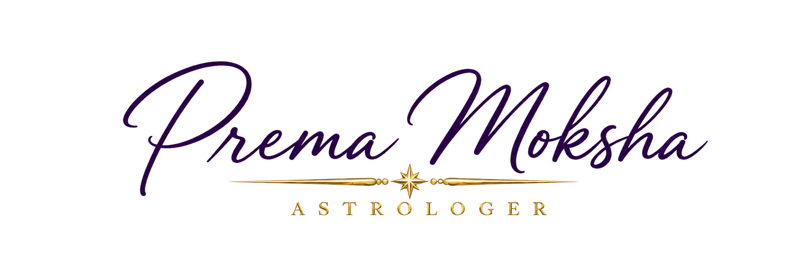

You find great joy when you discover a subject within Astrology that is new to you and makes a lot of sense, and you spend a huge number of hours and days deciphering that new angle, testing it through your memories and your relationships and your journals and life story before you bring it to your friends to check and confirm, and eventually to your clients at a slower pace to identify if the technique works. And all of that is great fun for you. You feel engaged, joyful, and your passion button is turned on. You cannot read words fast enough and start writing and drawing and color coding until things start to click, and the rush of mental satisfaction drizzles in. That is pure satisfaction with what you do and the joy of doing something you love.

When I was a toddler, most women in my family were teachers, and they were always ignoring me because they were busy with books, hundreds of homework assignments to go through, and the dual life of the teacher who is also a single mother in the 70s, when computers were a dream. I was amidst books, inside boxes of books and under teachers' chairs my entire childhood. I had no option but to develop a coping mechanism with books, through which I healed every emotional upset with hours of intellectual work. Astrology is the profession of the bookworm because you must read a whole library full of testimonies to believe it to start with. When that belief is ingrained in you, you try that on everyone you know, and you start to notice that certain patterns and archetypes seem to repeat themselves right in front of your eyes. Your drive intensifies because now you have something to investigate, and if you do a large enough amount of qualitative research, you begin to recognize recurring themes in the way people experience life, relationships, and the world around them.

In my teen years, when my family tried to extinguish the fire of my rebellious spirit, Astrology became an obsession because it gave me answers about everyone around me that I was trying to understand, so I could maybe beat the odds in my favor. I was always plotting my victory over the world that was trying to reduce me to one of the normal ones, while "crazy" was so much more interesting than everything else they wanted me to choose. Why? Because crazy was not crazy at all. Crazy was knowledge, a new knowledge that was starting to spread thanks to Liz Greene, and a new knowledge that could help me get ahead a little by understanding the mechanics of the human psyche.

I never stopped using Astrology, and the more I understand it, the more I understand how deeply interconnected the universe is. It is very insane that the universe has these extraordinary mathematical patterns that repeat in planetary movements, in cycles of nature, in the organization of living systems, and somehow I keep finding what seems to me to be a synchronicity between these patterns and our social spheres here on Earth. The human psyche, and that part of us that is purely feral and of this Earth, is not something separate from nature. We are nature, and I have always wondered whether the patterns we observe in the heavens and those we experience in human life are synchronistically connected by consciousness or by the spontaneous self-organization of the Universe itself.

I don't think there is a relationship of causation between Planets and the parts of the planets, including humans. The planets are not making us behave in a particular way, but I imagine the connection as something closer to parallel emergence, where patterns appear in different parts of existence without one necessarily causing the other. It is almost an automatic response in my mind that what happens above reflects below and vice versa. Sometimes it almost feels as though things are happening because they were meant to happen this way, for reasons that are beyond me. And when I look at historical periods of revolutionary change and compare them with the ephemeris, particularly the larger cycles involving Uranus, Pluto and Neptune, I find correspondences that make me want to investigate further because rather than saying this is not possible, I ask the Universe, "Why are these planetary alignments always appearing when these things are happening among humans?" The only explanation that does not make me pursue yet another degree is the existence of the Web of Life, which I took from an old book by Fritjof Capra.

Science already tells us that humans belong to a much larger system of interconnected parts, that we exist within ecosystems, biological systems, planetary systems, and larger physical structures, and that nature is full of cycles, relationships, and recurring patterns. We see them in the seasons, in the rhythms of living organisms, in ecological relationships, and in the mathematical organization of the physical world. But what fascinates me is the possibility that these patterns might also have correspondences in the human psyche because we respond to the environment. It is my opinion that everything is responding to everything.

We are made of Universal matter, subject to its physical laws, and our very existence is the result of billions of years of cosmic and biological evolution. And somewhere along this extraordinary journey, Energy developed the ability to become conscious of itself and ask questions about the universe it belongs to. How insane is that?

Perhaps because my mind operates in a systemic way that sees patterns and cycles, is the reason that I am an Astrologer. Because Astrology has always been for me, a language through which I can make sense of the Web of Life, and, more than anything else, what my part is within this organized chaos.

Do you want to know if you are an Astrology-inclined person? You got to the end of this text. Only a star lover would get here.

